# Bato (Smart Nepal Tourist & Trek Guide) — Database Design

Drafted 2026-11-05 · PostgreSQL · See also [techstack.md](../../docs/design/techstack.md), [algorithm.md](algorithm.md)

**ER diagram (core entities, for the report):** [docs/diagrams/er_diagram.png](../../docs/diagrams/er_diagram.png) · source: [docs/diagrams/er_diagram.svg](../../docs/diagrams/er_diagram.svg), regenerate with `python3 docs/diagrams/make_er_diagram.py`

---

## 1. Design Decisions

| Decision | Choice | Reason |
|---|---|---|
| Primary keys | **UUID** | The app creates records offline (trips, check-ins) before syncing; UUIDs avoid ID clashes |
| Translations | **One translation table per entity** (`place_translation`, `trek_translation`, …) | Real foreign keys, clean ER diagram, a new language needs no schema change |
| Location | Plain `latitude` / `longitude` (numeric) | Haversine is implemented in our own code; PostGIS not needed |
| Places vs treks | Separate tables; a trek is a sequence of **stages**, each stage goes **from one place to another** | Altitude is stored once (on the place); sleeping altitude = destination place's altitude |
| Trek start/end | **Not stored**; derived from the first and last stage | Avoids redundant data (normalisation) |
| Offline sync | Syncable tables have `updated_at` and `deleted_at` (soft delete) | Delta sync: "everything changed since time X", including deletions |
| Fixed value sets | PostgreSQL **enums** for fixed sets; **tables** for admin-managed lists (categories, permits, interests) | Simple, and admins can still add categories |
| Health data | **Optional** fields, used only for risk prediction | Sensitive personal data; user can skip |
| Reviews | For **places and treks** (exactly one per review, enforced by CHECK) | More useful feature |
| ML data | Training samples and model versions stored **in the database** | Supports admin "upload dataset / retrain model" |
| Not in the database | Weather (Redis cache), map tiles (phone), UI text (`en.json` / `ne.json`) | Cache or static files |

## 2. Enums

| Enum | Values |
|---|---|
| `lang` | en, ne |
| `user_role` | traveller, admin |
| `auth_provider` | email, google |
| `fitness_level` | low, medium, high |
| `trek_experience` | none, beginner, experienced |
| `travel_style` | solo, family, group |
| `budget_level` | low, medium, high |
| `risk_level` | easy, moderate, hard, risky |
| `ml_algorithm` | decision_tree, random_forest |
| `check_in_status` | pending, done, missed |
| `symptom_result` | ok, rest, descend |
| `review_status` | visible, hidden |
| `season` | spring, summer, autumn, winter, any |
| `nationality` | nepali, saarc, foreign *(V2 Phase 2: picks the permit / entry-fee rate)* |
| `packing_group` | clothing, gear, health, documents *(V2 Phase 1: sections of the packing checklist)* |

---

## 3. Tables

### A. Users & Authentication

**user**
| Column | Type | Notes |
|---|---|---|
| id | uuid | PK |
| email | text | unique, not null |
| password_hash | text | null for Google login (bcrypt) |
| full_name | text | |
| phone | text | |
| role | user_role | default traveller |
| auth_provider | auth_provider | |
| preferred_lang | lang | default en |
| is_blocked | boolean | default false; set by an admin. A blocked user gets 403 on login, token refresh and every API call |
| created_at, updated_at | timestamptz | |

**traveller_profile** (1–1 with user)
| Column | Type | Notes |
|---|---|---|
| user_id | uuid | PK, FK → user |
| date_of_birth | date | |
| fitness_level | fitness_level | |
| trek_experience | trek_experience | |
| has_heart_condition | boolean | optional |
| has_asthma | boolean | optional |
| budget_level | budget_level | |
| travel_style | travel_style | |
| updated_at | timestamptz | |

**interest** — id (PK), code (nature, culture, adventure, religious) + **interest_translation** (interest_id, lang, name)

**user_interest** — user_id (FK), interest_id (FK); PK (user_id, interest_id)

**emergency_contact** — id (PK), user_id (FK), name, phone, relation

**device_token** — id (PK), user_id (FK), fcm_token (unique), platform (android/ios), created_at

### B. Content (Places & Treks)

**category** — id (PK), code (unique), icon + **category_translation** (category_id, lang, name)

**area** *(V2-SR-14, migration 0007)* — id (PK), code (unique: `pokhara`, `kathmandu_valley`, `khumbu`, …), name_en, name_ne, other_names (text[], default `{}`: "Lakeside", "पोखरा", …). A city or trek region travellers search for, which is not a district (Pokhara is in Kaski district). For a trek region the code equals `trek.region` in lower case, so a region search also finds its treks. Loaded from `data/areas.csv`; `GET /areas` lists them

**place**
| Column | Type | Notes |
|---|---|---|
| id | uuid | PK |
| category_id | uuid | FK → category |
| latitude, longitude | numeric(9,6) | |
| altitude_m | int | |
| district, province | text | |
| area_id | uuid | FK → area, `ON DELETE SET NULL`, indexed; null = not in a known city or region *(V2-SR-14, migration 0007)* |
| entry_fee_npr | int | foreign rate; null = free |
| entry_fee_saarc_npr | int | SAARC rate; null/0 = free *(V2 Phase 2)* |
| entry_fee_nepali_npr | int | Nepali rate; null/0 = free *(V2 Phase 2)* |
| tags | varchar(30)[] | codes from `PLACE_TAGS` (sunrise, mountain_views, …), default `{}`; from `data/place_tags.csv`, edited in the admin panel *(V2-SR-07, migration 0006)* |
| is_published | boolean | |
| updated_at, deleted_at | timestamptz | sync |

**place_translation** — PK (place_id, lang); name, description, how_to_reach, is_machine_translated, is_reviewed, reviewed_by (FK → user), **name_latin** *(V2-SR-08, migration 0006)*: the name in Latin letters (पोखरा → "pokhara"), filled automatically on every insert/update by a SQLAlchemy event with `to_latin()`, GIN trigram index `ix_place_translation_name_latin_trgm` for search

**place_alias** — id (PK), place_id (FK), alias (e.g. "Anapurna", "अन्नपूर्ण") — search with trigram + Levenshtein

**place_photo** — id (PK), place_id (FK), url, sort_order

**place_climate** — PK (place_id, month 1–12); avg_temp_c, rainfall_mm, visibility_score — "best time to visit"

**trek**
| Column | Type | Notes |
|---|---|---|
| id | uuid | PK |
| region | text | e.g. Annapurna, Khumbu, Langtang |
| total_days | int | |
| total_distance_km | numeric | |
| max_altitude_m | int | |
| base_difficulty | risk_level | agency rating |
| is_published | boolean | |
| updated_at, deleted_at | timestamptz | sync |

**trek_translation** — PK (trek_id, lang); name, overview, is_machine_translated, is_reviewed, **name_latin** (same as on place_translation; index `ix_trek_translation_name_latin_trgm`)

**trek_stage**
| Column | Type | Notes |
|---|---|---|
| id | uuid | PK |
| trek_id | uuid | FK → trek |
| day_no | int | unique per trek |
| from_place_id | uuid | FK → place |
| to_place_id | uuid | FK → place (sleeping altitude) |
| distance_km | numeric | |
| walk_hours | numeric | |
| highest_point_m | int | pass on the way, if higher than both ends |

**stage_translation** — PK (stage_id, lang); notes

**permit** — id (PK), code (TIMS, ACAP, SNP…), fee_nepali_npr, fee_saarc_npr, fee_foreign_npr + **permit_translation** (permit_id, lang, name, description)

**trek_permit** — PK (trek_id, permit_id)

**teahouse** *(V2 Phase 2)* — id (PK), place_id (FK → the village, index), phone, has_wifi, has_hot_shower (null = not known), source (where the lodge comes from; required in the admin form), updated_at, deleted_at (soft delete) + **teahouse_translation** — PK (teahouse_id, lang); name, price_note. Seeded from `data/teahouses.csv` with real lodges only (no invented names or phone numbers)

**packing_item** *(V2 Phase 1, migration 0005)* — id (PK), code (unique), group (`packing_group`), sort_order, and the rule columns: always (bool), min_altitude_m (null = not used), months (`smallint[]`, empty = any month), min_days (null = not used), updated_at. `CHECK has_rule`: an item that is not `always` needs at least one condition; `CHECK months <@ {1..12}`. Seeded from `data/packing_items.csv` (34 rules) + **packing_item_translation** — PK (item_id, lang); name, note (short tip, e.g. "Ask a doctor before the trek"). Permits are not rows here: the packing list adds the trek's own `trek_permit` rows as documents

### C. Trip Planner

**trip** — id (PK), user_id (FK), title, start_date, total_days, total_km (length of the optimised route), estimated_budget_npr (saved by "Estimate budget"; cleared with the plan when stops change), share_token (unique; `secrets.token_urlsafe(16)` = 128 random bits; null = not shared), updated_at, deleted_at

**trip_stop** — id (PK), trip_id (FK), place_id (FK), visit_order (TSP + 2-opt), day_no (greedy split), visit_hours (default 1.5, CHECK 0 < hours ≤ 12), added_at. The API refuses the same place twice in a trip (409). Adding or removing a stop clears visit_order, day_no and total_km, so the trip must be optimised again

**dismissed_item** *(V2-SR-03, migration 0006)* — id (PK), user_id (FK → user, cascade, indexed), place_id (FK, nullable), trek_id (FK, nullable), created_at. "Not interested" on a recommendation: the item is not recommended again until undone, and it counts as a −1 signal for the user's taste. `CHECK one_target` (exactly one of place/trek); partial unique indexes `uq_dismissed_user_place` / `uq_dismissed_user_trek`, so saying it twice is harmless (`ON CONFLICT DO NOTHING`)

### D. AI / ML

**ml_model** — id (PK), version, algorithm, accuracy, f1_score (macro), trained_at, is_active (only one active: partial unique index), file_path (relative to `backend/`)

**training_sample**
| Column | Type |
|---|---|
| id | uuid (PK) |
| max_altitude_m | int |
| max_daily_gain_m | int |
| total_days | int |
| distance_per_day_km | numeric |
| month | int |
| age | int |
| fitness_level | fitness_level |
| trek_experience | trek_experience |
| has_health_issue | boolean |
| label | risk_level |
| source | text (agency / survey / rule) |

**risk_prediction** — id (PK), user_id (FK), trek_id (FK), model_id (FK), month, predicted_level (risk_level), confidence, reason_codes (jsonb, e.g. `["HIGH_DAILY_GAIN","BEGINNER"]`), input_snapshot (jsonb), created_at

### E. Safety

**sos_event** — id (PK), user_id (FK), latitude, longitude, message, sent_at

**check_in** — id (PK), trip_id (FK), user_id (FK), due_at, checked_in_at, status (check_in_status), latitude, longitude

**symptom_check** — id (PK), user_id (FK), trek_id (FK, nullable), altitude_m, headache, gi_symptoms, fatigue, dizziness (each 0–3), total_score, result (symptom_result), created_at

### F. Community

**review** — id (PK), user_id (FK), place_id (FK, nullable), trek_id (FK, nullable), rating (1–5), comment (≤ 1,000 chars, checked by the API), lang (from `Accept-Language`), status, created_at, updated_at *(V2)*
`CHECK ((place_id IS NULL) <> (trek_id IS NULL))` — exactly one target
**One review per user and item** *(V2 Phase 2, migration 0004)*: partial unique indexes `uq_review_user_place (user_id, place_id) WHERE place_id IS NOT NULL` and `uq_review_user_trek (user_id, trek_id) WHERE trek_id IS NOT NULL`. A second post is an `INSERT … ON CONFLICT DO UPDATE` on these indexes, so it updates the review (an admin's *hidden* stays hidden)

### G. Budget *(V2 Phase 2)*

**budget_rate** — PK (budget_level, region); food_per_day_npr, stay_per_day_npr, transport_per_km_npr (city trips), trailhead_transport_npr (treks: Kathmandu ↔ trailhead and back), updated_at. `region` is `city` for sightseeing trips, a trek region (Annapurna, Khumbu, Langtang, Manaslu), or `other` (used for a trek region without its own rows). Seeded from `data/budget_rates.csv`, editable in the admin panel

**traveller_profile.nationality** — `nationality` enum, NOT NULL, default `foreign`

**favourite** — PK (user_id, place_id)

---

## 4. Full ER Diagram (all tables, Mermaid)

```mermaid
erDiagram
    USER ||--o| TRAVELLER_PROFILE : has
    USER ||--o{ USER_INTEREST : selects
    INTEREST ||--o{ USER_INTEREST : chosen_in
    USER ||--o{ EMERGENCY_CONTACT : has
    USER ||--o{ DEVICE_TOKEN : registers
    USER ||--o{ TRIP : plans
    TRIP ||--o{ TRIP_STOP : contains
    PLACE ||--o{ TRIP_STOP : visited_in
    CATEGORY ||--o{ PLACE : groups
    AREA |o--o{ PLACE : contains
    CATEGORY ||--|{ CATEGORY_TRANSLATION : translated_as
    PLACE ||--|{ PLACE_TRANSLATION : translated_as
    PLACE ||--o{ PLACE_ALIAS : known_as
    PLACE ||--o{ PLACE_PHOTO : has
    PLACE ||--o{ PLACE_CLIMATE : has
    PLACE ||--o{ TEAHOUSE : has
    TEAHOUSE ||--o{ TEAHOUSE_TRANSLATION : "translated as"
    BUDGET_RATE }o--o{ TRIP : "priced by (no FK)"
    TREK ||--|{ TREK_STAGE : consists_of
    PLACE ||--o{ TREK_STAGE : from_or_to
    TREK ||--|{ TREK_TRANSLATION : translated_as
    TREK_STAGE ||--o{ STAGE_TRANSLATION : translated_as
    TREK ||--o{ TREK_PERMIT : requires
    PERMIT ||--o{ TREK_PERMIT : used_in
    PERMIT ||--|{ PERMIT_TRANSLATION : translated_as
    PACKING_ITEM ||--|{ PACKING_ITEM_TRANSLATION : translated_as
    USER ||--o{ RISK_PREDICTION : requests
    TREK ||--o{ RISK_PREDICTION : for
    ML_MODEL ||--o{ RISK_PREDICTION : produces
    USER ||--o{ REVIEW : writes
    PLACE |o--o{ REVIEW : about
    TREK |o--o{ REVIEW : about
    USER ||--o{ FAVOURITE : saves
    PLACE ||--o{ FAVOURITE : saved_in
    USER ||--o{ SOS_EVENT : sends
    USER ||--o{ CHECK_IN : performs
    TRIP ||--o{ CHECK_IN : tracked_by
    USER ||--o{ SYMPTOM_CHECK : records
    TREK |o--o{ SYMPTOM_CHECK : during
```

(TRAINING_SAMPLE stands alone: it feeds model training, not other tables.)

---

## 5. Indexes (performance)

- `place (latitude, longitude)` — bounding-box filter for "Near me". With 69 places PostgreSQL picks a sequential scan (cheaper for a tiny table); with `enable_seqscan = off` the plan is a Bitmap Index Scan on `ix_place_lat_lng`, so the index is used once the table grows
- `review` partial unique `(user_id, place_id)` / `(user_id, trek_id)` — one review per user and item
- `teahouse (place_id)` — teahouses of a village
- `place_alias` and `place_translation.name` — `pg_trgm` GIN index for fuzzy search
- `place (area_id)` — all places in a city or trek region (search, `/places?area=`)
- `trek_stage (trek_id, day_no)` unique
- `updated_at` on every syncable table — offline delta sync
- `risk_prediction (user_id, created_at)` — user history
- `check_in (status, due_at)` — missed check-in job
